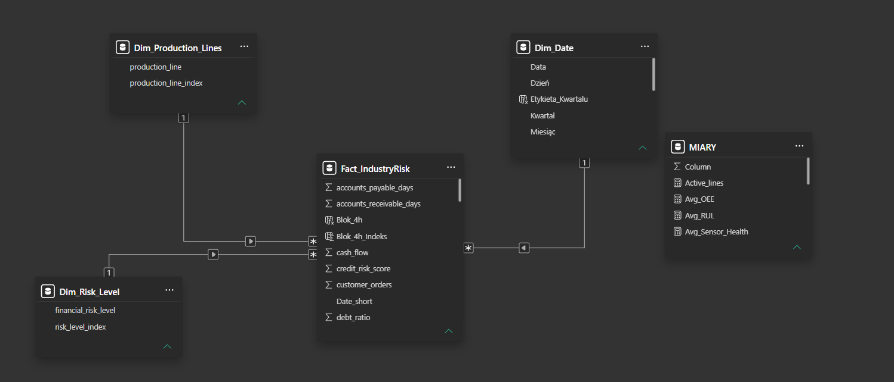
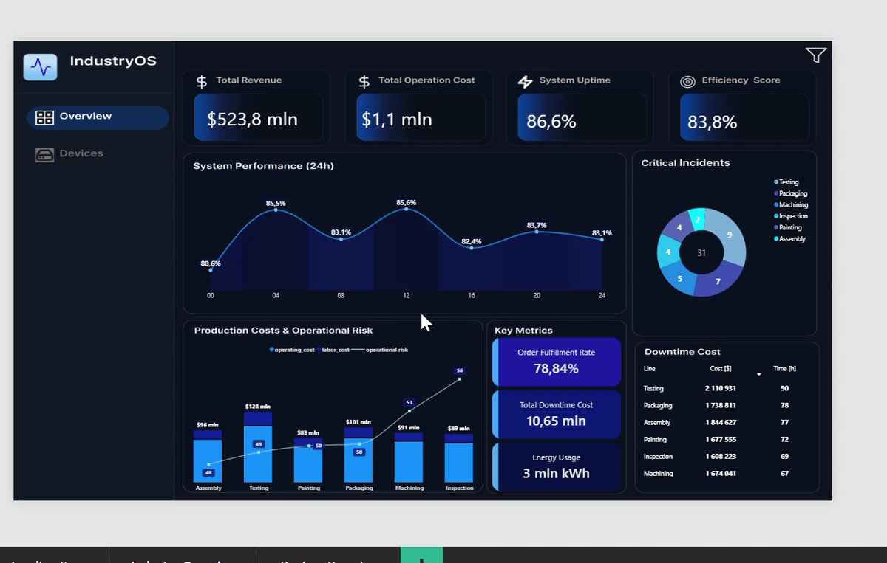
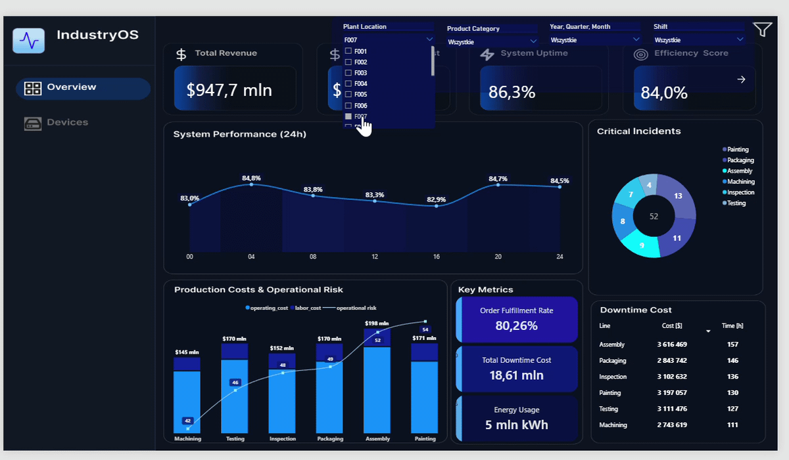
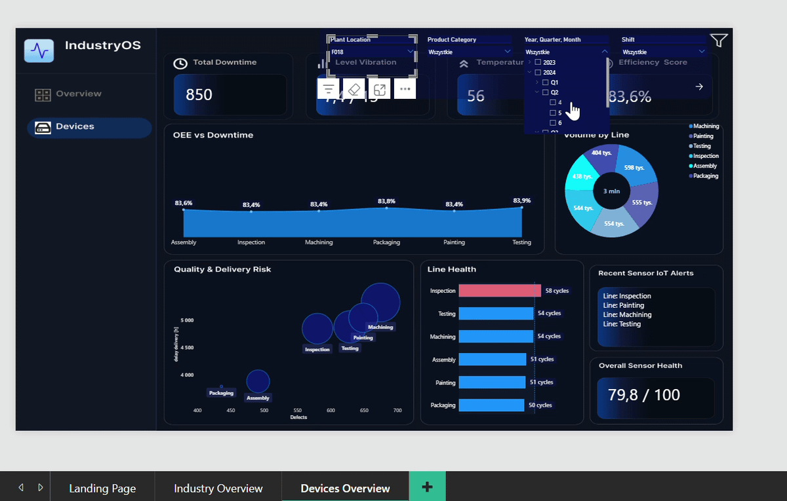

# 🏭 Dashboard Power BI –Nowoczesna Analityka Przemysłowa 4.0 (Case&nbsp;Study)


Cześć!, <br><br> dziękuję że odwiedzasz moje repozytorium! Zapraszam cię do zapoznania się z kolejnym projektem.  <br> Jest to 2-stronicowy raport Power BI dla fabryki w rewoluji 4.0, połączony z analizą wydajności linii produkcyjnych (OEE), przestojów oraz telemetrii czujników IoT (wibracji i temperatury). <br> <br> Na szczególną uwagę zasługuje autorski design stron raportu. Tła kanwy od podstaw zaprojektowałem w programie Figma, co pozwoliło uzyskać przejrzysty i spójny wizualnie interfejs.

### Możesz pobrać gotowy plik i przetestować go samodzielnie:

<p align="left">
  <a href="Plik z raportem/Nowoczesna_Fabryka_Raport.pbix">
    
  </a>
</p>
---

### Uwaga

Plik .pbix zawiera kompletnie załadowany i gotowy model danych. <br>Do repozytorium dołączono również pliki źródłowe w folderze **/dataset**. <br> Aby przeprowadzić ponowne odświeżenie (Refresh) w Power Query, wystarczy wskazać nową ścieżkę do plików na swoim dysku lokalnym.

---

<br>

<div id="menu" align="center">

### Wybierz stronę raportu do podglądu:

<p align="center">
  <a href="#strona-1">
    
  </a>
  <a href="#strona-2">
    
  </a>
</p>

</div>

<br>
<hr>
<br>

---

### 📚 Spis treści
<div id="1-wstęp"></div>
<details>
<summary><b>1. Case Study – Pytania biznesowe (odpowiedzi w pkt 8.)</b> <i>(kliknij, aby rozwinąć)</i></summary>

<br>

Zarząd oraz inżynierowie utrzymania ruchu potrzebują spójnego, centralnego wglądu w realną efektywność parku maszynowego i telemetrię IoT.

Pytania główne:

&emsp;**1. Jak kształtuje się dobowa krzywa wydajności w wybranym zakładzie P007 w 3 kwartale 2024 i w których przedziałach godzinowych spada ona poniżej średniego poziomu dostępności?**

&emsp;**2. Które linie produkcyjne generują największe ryzyko jakościowe i opóźnienia w dostawach w zakładzie F010 dla kategorii produktów Food?**

&emsp;**3. Które obszary produkcji w zakładzie F001 (2023 r.) generowały najwyższe koszty przestojów (Downtime Cost)**

Pytanie szczegółowe: 

&emsp;**1. Jak prezentuje się stan sensorów IoT w ujęciu ostatniego tygdodnia i w których fabrykach wskaźnik ten utrzymuje się powyżej bezpiecznego progu 70 punktów bez rejestracji alarmów krytycznych?**
<br>
<br>
<br>
<br>


</details>

<div id="2-dane"></div>
<details>
  
<summary><b> 2. Dane do raportu</b> <i></i></summary>

<br>

#### a. Źródło danych
* **Publiczny zbiór danych z platformy Kaggle (Industry 4.0 Financial Risk Dataset), plik w formacie *.csv zaciągany i modelowany za pomocą SQL Server

#### b. Zakres 
* **Czas:** Wymiar uwzględniający lata, kwartały, miesiące oraz cykle dobowe (24h) i zmiany robocze.
* **Lokalizacja i produkcja:** Fabryki / Zakłady (Plant Location, np. F010, F001) oraz kategorie produktów (Product Category, np. Food) i linie produkcyjne.
* **IoT i Stan techniczny:** Telemetria sensorów, wskaźniki zdrowia urządzeń, poziomy wibracji.

  
#### c. Miary operacyjne i finansowe m.in.
* **Wydajność i dyspozycyjność:** System_Uptime, Efficiency_Score, Production_volume, Order_Fulfillment_Rate.
* **Przestoje i ryzyko:** Downtime_Hours, Sensor_Health, RUL
* **Koszty i finanse:** Total_Revenue, Total_Operation_Cost, Total_Maintenance_Cost.
<br>
<br>
<br>
<br>

</details>

<div id="3-model-danych"></div>
<details>
<summary><b> 3. Model danych </b> <i></i></summary>

<br>

Model danych został zorganizowany wokół centralnej tabeli faktów:

* **Tabela Faktów** (`Fact_IndustryRisk`): Główna tabela transakcyjna zawierająca kluczowe metryki operacyjne, telemetrię IoT oraz wskaźniki ryzyka finansowego i produkcyjnego (m.in. koszty, przepływy, opóźnienia i wskaźniki awaryjności).
* **Tabele Wymiarów** (`Dim_Production_Lines`, `Dim_Risk_Level`, `Dim_Date`):

`Dim_Production_Lines` – słownik linii produkcyjnych powiązany relacją jednokierunkową 1: (Jeden do Wiele)* z tabelą faktów.

`Dim_Risk_Level` – słownik poziomów ryzyka finansowego.

`Dim_Date` – dedykowana tabela kalendarza połączona relacją 1: (Jeden do Wiele)*, umożliwiająca zaawansowaną analizę czasową.<br>

* **Tabela Miar (`MIARY`):** Osobna tabela techniczna służąca jako spójny kontener na wszystkie utworzone miary DAX.

<!-- Podgląd schematu relacji w Power BI -->
<p align="center">
  
</p>
<br>
<br>
<br>
<br>
</details>

<div id="4-projekt-ui-ux-figma"></div>
<details>
<summary><b> 4. Projekt widoków w Figma  </b> <i></i></summary>
<br>

Zanim powstał raport w Power BI, cały interfejs został zaprojektowany od podstaw w programie **Figma**. <br>Takie podejście pozwoliło na spójne zaplanowanie architektury informacji, hierarchii wizualnej oraz customowych elementów graficznych.

- Projekt został zrobiony na przemyślanej palecie kolorów nawiązującej do przemysłu i IoT (głębokie, ciemne błękity tła, nowoczesny cyjan).
- Stworzyłem makiety dla 2 głównych zakładek analitycznych oraz strony startowej (Landing Page):
  * *Industry Overview* – kafle KPI (przychody, koszty operacyjne, Uptime, wskaźnik efektywności), incydenty krytyczne oraz koszty przestojów.
  * *Devices Overview* – telemetria sensorów, wibracje, temperatura, analiza OEE vs przestępy

- Tła oraz statyczne elementy interfejsu wygenerowałem jako czyste grafiki w Figmie i importowałem bezpośrednio do Power BI jako tło kanwy.

#### 🎨 Makiety layoutów:

<table>
  <tr>
    <td width="50%" align="center">
      <b>Strona Startowa</b><br>
      
    </td>
    <td width="50%" align="center">
      <b>Przegląd Fabryki</b><br>
      
    </td>
  </tr>
  <tr>
    <td width="50%" align="center">
      <b>Analiza Urządzeń</b><br>
      
    </td>
  
  </tr>
</table>
<br>
<br>
<br>
<br>
</details>

<div id="5-Logika i dax"></div>
<details>
<summary><b> 5. Logika biznesowa i kluczowe miary DAX </b> <i></i></summary>
<br>

Aby przeanalizować kluczowe wskaźniki efektywności i ryzyka w przemyśle 4.0, stworzyłem dedykowany zestaw 14 miar DAX. Oto kilka z nich:

#### 1. Średni wskaźnik OEE (Avg_OEEue). Średnia ważona.

```dax
Avg_OEE = 
DIVIDE(
    SUMX(
        Fact_IndustryRisk,
        Fact_IndustryRisk[overall_equipment_effectiveness] * Fact_IndustryRisk[production_volume]
    ),
    SUM(Fact_IndustryRisk[production_volume]) * 100,
```

**Cel analityczny:** Monitorowanie ogólnej efektywności wyposażenia (Overall Equipment Effectiveness), stanowiące podstawowy miernik wydajności produkcyjnej fabryi.
Używam średniej ważonej aby lepiej oddać obraz fabryki, ponieważ poszczególne wiersze różnią się wolumenem lub czasem pracy.

---

#### 2. Całkowity czas przestojów w godzinach (Total_Downtime_Hours)

```dax

Total_Downtime_Hours = 
SUM(Fact_IndustryRisk[machine_downtime_min]) / 60

```

**Cel analityczny:** Agregacja całkowitego czasu przestojów maszyn, co pozwala identyfikować główne wąskie gardła i opóźnienia w dostawach.

---

#### 3. Dynamiczny komunikat alertów sensorów IoT (Sensor_Alert_Message)

```dax
Sensor_Alert_Message = 
IF(
    ISFILTERED(Fact_IndustryRisk[factory_id]),
    COALESCE(
        CONCATENATEX(
            VALUES(Fact_IndustryRisk[production_line]), 
            "Line: " & Fact_IndustryRisk[production_line], 
            UNICHAR(10)
        ),
        "✅ All systems normal"
    ),
    BLANK()
)
```

**Cel analityczny:** Dynamiczne zarządzanie treścią komunikatu na kafelku wizualnym w zależności od kontekstu filtrowania.

---

#### 4. Całkowite zużycie energii w kWh (Energy_Usage)

```dax
Energy_Usage = SUM(Fact_IndustryRisk[energy_consumption_kwh])

```
**Cel analityczny:** Podstawowa agregacja wolumenu zużycia energii elektrycznej w kWh dla wybranych linii produkcyjnych, fabryk lub okresów czasowych. Umożliwia monitorowanie energochłonności procesów przemysłowych.

---
<br>
<br>
<br>
<br>
</details>

<div id="6-prezentacja-wynikow"></div>
<details>
<summary><font color="#4dabf7"><b> 6. Data Storytelling & Wizualizacje (Przykłady)</b></font></summary>
  
<br>

Warstwa wizualna została zaprojektowana w oparciu o zasady Data Storytellingu. Kliknij poniżej, aby rozwinąć poszczególne widoki:

<br>

<!-- PUNKT 1 -->
<details>
<summary><b>Karty KPI (Widok Fabryka)</b></summary>

<p align="center">
    
</p>

- **Kluczowe wskaźniki operacyjne i finansowe**
  * **Total Revenue:** Główna wartość pokazująca całkowity przychód wygenerowany przez fabrykę w wybranym okresie.

  * **Total Operation Cost:** Sumaryczne koszty operacyjne i utrzymania ruchu w zakładach.

  * **System Uptime:** Wskaźnik dostępności i ciągłości pracy systemów produkcyjnych.
  
  * **Efficiency Score:** Ogólny wskaźnik efektywności i wydajności procesów produkcyjnych
 
  * **Cel analityczny:** Szybka ocena skali biznesu, bieżącej rentowności oraz gotowości operacyjnej zakładu już od pierwszych sekund patrzenia na dashboard
    
</details>

<br>

<!-- PUNKT 2 -->
<details>
<summary><b>Wykres warstwowy (Widok Fabryka)</b></summary>

<p align="center">
    
</p>

- **Wydajność systemowa w czasie:** Prezentuje dobową dynamikę oraz wahania ogólnej wydajności systemów  w ujęciu 24-godzinnym.
- Idealnie pokazuje ciągły proces i wahania w cyklu dobowym, czego słupki by nie oddały. Doskonale pasuje do ciemnego motywu (Dark Mode) i nowoczesnych paneli sterowania.
    
<span style="color: #4dabf7; font-weight: bold;">Cel analityczny:</span> Wizualna ocena amplitudy wahań oraz szybka identyfikacja szczytów wydajnościowych i spadków operacyjnych.
</details>

<br>

<!-- PUNKT 3 -->
<details>
<summary><b>Wykres pierścieniowy (Widok Fabryka)</b></summary>

<p align="center">
    
</p>

- Wykres prezentuje udział oraz strukturę incydentów krytycznych w podziale na poszczególne obszary i etapy procesu produkcyjnego, z łączną sumą zdarzeń wyeksponowaną w centrum wykresu.
-   
<span style="color: #4dabf7; font-weight: bold;">Cel analityczny:</span> Szybka identyfikacja najbardziej awaryjnych obszarów fabryki i priorytetyzacja działań
</details>

<br>

<!-- PUNKT 4 -->
<details>
<summary><b>Wykres liniowy skumulowany kolumnowy (Widok Fabryka)</b></summary>

<p align="center">
    
</p>
  
- Wykres przedstawia strukturę kosztów operacyjnych (operating_cost) oraz kosztów pracy (labor_cost) w podziale na linie/obszary produkcyjne, z dodatkową osią dla wskaźnika ryzyka operacyjnego (operational_risk).
- Wybór wizuala jest przemyślany ponieważ pozwala zestawić na jednym wykresie dwie zupełnie różne miary – strukturę finansową (koszty operacyjne i pracy) oraz wskaźnik ciągły (ryzyko operacyjne), oszczędzając miejsce na dashboardzie.
  
<span style="color: #4dabf7; font-weight: bold;">Cel analityczny:</span> Korelacja kosztów operacyjnych i pracowniczych z ryzykiem awarii w celu optymalizacji budżetu. Nałożona linia ryzyka pozwala w ułamku sekundy zauważyć, czy drogie w utrzymaniu linie produkcyjne są jednocześnie tymi o najwyższym ryzyku awarii.
</details>

<br>

<!-- PUNKT 5 -->
<details>
<summary><b>Wykres punktowy (Widok Urządzenia)</b></summary>

<p align="center">
    
</p>
  
- Wykres przedstawia  relację liczby wad (Defects) i opóźnień dostaw w podziale na obszary produkcyjne, z rozmiarem bąbelka jako dodatkową miarą wagową.   
- Wykres szybko uwypukla krytyczne obszary leżące w prawym górnym rogu (wysokie opóźnienia i dużo wad).
  
<span style="color: #4dabf7; font-weight: bold;">Cel analityczny:</span> Identyfikacja obszarów generujących największe ryzyko jakościowe i logistyczne, co pozwala na priorytetowe eliminowanie wąskich gardeł dostaw.
</details>
<br>
<br>
<br>
<br>
</details>

<div id="7-interaktywnosc-raportu"></div>
<details>
<summary><b> 7. Doświadczenia użytkowania (Rozbudowany Panel Filtrów i Nawigacja)</b></summary>

<br>

Raport został zaprojektowany z naciskiem na nowoczesny interfejs oraz optymalizację przestrzeni roboczej:

- **Chowany Panel Filtrów (Selection & Bookmarks):**  
  Zamiast zagracać przestrzeń statycznymi filtrami, utworzyłem dynamiczny panel wysuwany za pomocą ikony suwaków. Wykorzystując *Zakładki (Bookmarks)* oraz panel *Wybór (Selection)*, użytkownik może w każdej chwili włączyć lub ukryć filtry (`filters on / off`)

<p align="center">
  
</p>

<br>

- **Panel Nawigacyjny:**  
  Po lewej stronie zaimplementowałem spójny, estetyczny panel boczny z przyciskami, który umożliwia szybkie i płynne przełączanie się pomiędzy głównymi widokami raportu, zapewniając doświadczenia zbliżone do nowoczesnych aplikacji.

<p align="center">
  
</p>
<br>
<br>
<br>
<br>
</details>

<div id="8-wnioski-biznesowe"></div>
<details>
<summary><b>8. Case Study – Odpowiedzi</b> <i>(kliknij, aby rozwinąć)</i></summary>

<br>

Projekt został zrealizowany pod kątem konkretnych pytań analitycznych postawionych na starcie. Oto najważniejsze wnioski z raportu:


<details>
<summary><b>&emsp; Pytanie Główne 1:  Jak kształtuje się dobowa krzywa wydajności (System Performance 24h) w wybranym zakładzie P007 w 3 kwartale 2024 i w których przedziałach godzinowych spada ona poniżej średniego poziomu dostępności (System Uptime)? </b></summary>

<br>

Mimo wysokiej ogólnej dostępności parku maszynowego (~87%), analiza krzywej dobowej ujawnia konkretne godziny spadku tempa produkcji, które wymagają optymalizacji. <br>
Wydajność pozostaje poniżej średniej dostępności w każdym punkcie pomiarowym – najwyższa jest na starcie doby o 00:00 (86,8%) oraz o 20:00 (85,9%). <br>
Największe osłabienie tempa produkcji występuje na przełomie zmian o godzinie 08:00 (82,6%) oraz 16:00 (81,5%). <br>


<table align="center" style="border: none;">
  <tr>
    <td align="center" style="border: none; padding: 10px;">
      
    </td>
  </tr>
</table>

</details>

<details>
<summary><b>&emsp; Pytanie Główne 2: Które linie produkcyjne generują największe ryzyko jakościowe i opóźnienia w dostawach w zakładzie F010 dla kategorii produktów Food?</b></summary>

<br>
Linia pakowania generuje zdecydowanie największe opóźnienia w dostawach przekraczające 1000 godzin (co widać po najwyższym położeniu na osi Y wykresu Quality & Delivery Risk oraz największy bąbel oznaczający skalę problemu. <br> Wiąże się to z największymi przestojami (37 h) i niższą wydajnością OEE na poziomie 83,1%.


<table align="center" style="border: none;">
  <tr>
    <td align="center" style="border: none; padding: 30px;">
      
    </td>
  </tr>
</table>
</details>


<details>
<summary><b>&emsp; Pytanie Główne 3: Które obszary produkcji w zakładzie F001 (2023 r.) generowały najwyższe koszty przestojów (Downtime Cost)?</b></summary>

<br>

Główne źródło strat finansowych to linia Testing. Łączny koszt przestojów (Total Downtime Cost) wyniósł 10,65 mln $, z czego największy udział miała linia Testing generująca stratę 2 110 931 $ przy 90 godzinach przestoju oraz 9 incydentach krytycznych.<br> Na drugim miejscu pod względem kosztów przestojów uplasowała się linia Assembly (1 844 627, 77 h), a tuż za Packaging (1 738 811, 78 h i 7 incydentów krytycznych).


<table align="center" style="border: none;">
  <tr>
    <td align="center" style="border: none; padding: 30px;">
      
    </td>
  </tr>
</table>
</details>


<details>
<summary><b>&emsp; Pytanie Szczegółowe: Jak prezentuje się stan sensorów IoT (Overall Sensor Health) w ujęciu ostatniego tygodnia i w których fabrykach wskaźnik ten utrzymuje się powyżej bezpiecznego progu 70 punktów bez rejestracji alarmów krytycznych?</b></summary>

<br>

W fabrykach F010 oraz F019 stan sensorów stabilnie utrzymuje się powyżej ustalonego progu 70 punktów, co potwierdza brak alarmów krytycznych i status komunikatów jako All systems normal.


<table align="center" style="border: none;">
  <tr>
    <td align="center" style="border: none; padding: 30px;">
      
    </td>
  </tr>
</table>

<br>

W pozostałych zakładach park maszynowy wykazuje punktowe przekroczenia progów ostrzegawczych na podanych liniach w sekcji Recent Sensor IoT Alerts.

<br>

<table align="center" style="border: none;">
  <tr>
    <td align="center" style="border: none; padding: 30px;">
      
    </td>
  </tr>
</table>
</details>

</details>


<br><br><br><br><br><br><br><br>
<br><br><br><br>
<br><br><br><br>
<br><br><br><br>
<br><br><br><br>
<br><br><br><br>

<!-- Sekcja Strony 1 -->
<div id="strona-1" align="center">

### Strona 1: Ogólny Przegląd Fabryki



<br>

<a href="#menu">
  
</a>

</div>

<br>
<hr>
<br>

<!-- Sekcja Strony 2 -->
<div id="strona-2" align="center">

### Strona 2: Analiza Parku Maszynowego



<br>

<a href="#menu">
  
</a>

</div>

<br>


